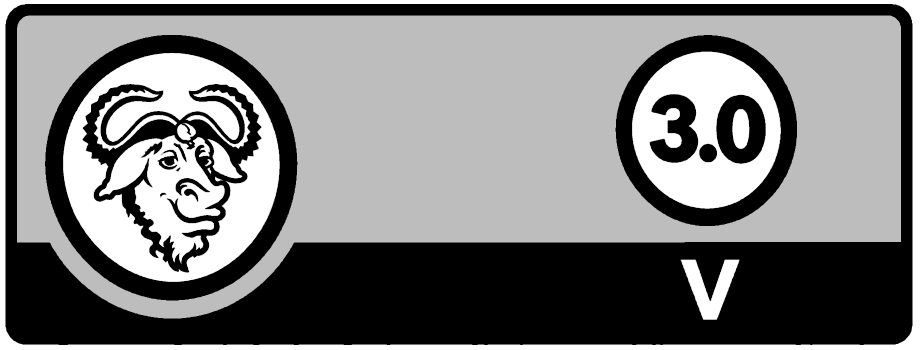
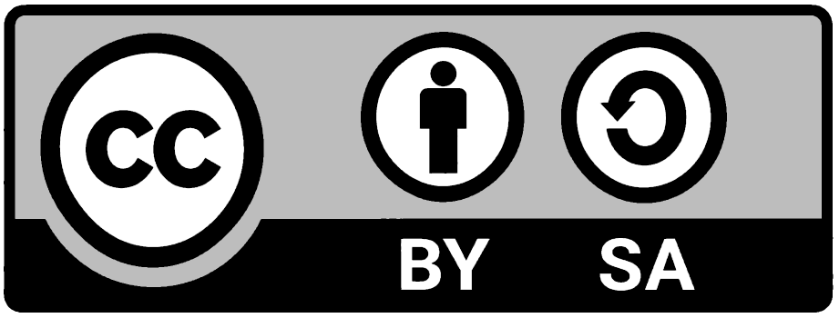

# Civica

A consistent Home Assistant theme and component system inspired by the GOV.UK Design System, using the supplied **Civica** identity. Seven theme colours from the GOV.UK colour palette, accessible light and dark modes, and a Theme colour control beside Home Assistant's theme settings.

This is an independent project. It is not a government service or an official Home Assistant product. Existing `govuk` entity IDs and the `govuk` theme name remain compatible with older installations. The ten earlier palette themes, such as `civica Civic Cobalt Vivid`, were replaced on 18 November 2026: choose a theme colour again after upgrading.

The repository is now `nathcymru/civica`. GitHub redirects old repository links. The documentation has moved to [nathcymru.github.io/civica](https://nathcymru.github.io/civica/); the former Pages address does not redirect.

## Start with the design system

The comprehensive [design system in `/docs`](docs/README.md) uses the **GOV.UK Tech Docs Template (`govuk_tech_docs` 6.6.0), powered by Middleman**. Its Get started, Styles, Components, Patterns, Community and Accessibility sections follow the official GOV.UK Design System's information architecture. That upstream website uses Node; this site deliberately implements the same organisation with the requested Middleman template.

- [Live design system](https://nathcymru.github.io/civica/)
- [Download the installation package](https://github.com/nathcymru/civica/releases/latest)
- [Install and upgrade](https://nathcymru.github.io/civica/get-started/install.html)
- [Colour and theme colours](https://nathcymru.github.io/civica/styles/colour.html)
- [Brand and artwork](ARTWORK.md)
- [AI reading guide](docs/source/llms.txt)
- [Theme colour data](design-system/palettes.json) and [resolved theme variables](design-system/themes.json)

## Included

- **Civica and 7 theme colours:** Blue, Green, Teal, Purple, Magenta, Red and Black, taken unchanged from the GOV.UK colour palette. Each passes 4.5:1 contrast with white text.
- **One shared token system:** native panels, dashboards, tables, forms, buttons, switches, dialogs, the lighting card and examples use consistent colours and surfaces. Error, warning and chart meanings stay independent of the selected theme colour.
- **ONS-based Energy charts:** the companion applies individual unfilled power lines, opaque consumption columns, consistent 1.5px strokes and matching keys to supported native Energy graphs, with an accessible View data table. Chart colours are the GOV.UK chart palette, unchanged in light and dark mode; each series also gets a stable pattern, line dash and marker, and the theme supplies 24 numbered fallback slots. Native statistics, date controls, comparisons and chart interaction are retained. See the [chart specification](https://nathcymru.github.io/civica/components/charts.html) and [working examples](https://nathcymru.github.io/civica/components/chart-examples.html).
- **Colour control:** a Theme colour selector beside Profile theme settings, plus a dashboard card fallback. Home Assistant handles application and preference storage. Light/Dark/Auto is preserved.
- **Civica assets:** supplied logos and icons, used without redrawing or recolouring. Original files and their checksum manifest are retained.
- **Lighting card repairs:** visible unavailable states, accessible errors, keyboard focus, touch targets, responsive layout and native dialog scrolling. Existing lighting automation and reserved-device behaviour are retained.

The theme colour is separate from Light/Dark. Dark mode uses documented, tested colour adaptations while keeping the exact theme colour in the header.

## Install the themes

Choose **HACS or manual installation** as the owner of the theme YAML. Home Assistant merges the included theme files, so a second copy with the same theme names can override newer definitions.

With HACS, add `https://github.com/nathcymru/civica` as a custom repository of type **Theme**, then download **Civica**. HACS installs and updates the YAML in its repository folder under `config/themes/`; an existing installation may use `config/themes/govuk/`. Keep that HACS-managed location. HACS does not install the optional companion or lighting card.

For manual installation without HACS, copy `themes/civica.yaml` to your Home Assistant `config/themes/civica/` directory once. Keep `themes/govuk.yaml` there only if an existing profile or dashboard uses the old `govuk` theme name. That alias now maps to the Blue theme colour. Keep only one included definition of the alias as well; do not add another `govuk.yaml` alongside an existing installation.

Merge this into your existing `configuration.yaml` without duplicating `frontend`:

```yaml
frontend:
  themes: !include_dir_merge_named themes
```

Restart after changing `configuration.yaml`. For theme-file changes alone, run **Settings → Tools → Actions → `frontend.reload_themes`**. In your **Profile**, choose `Civica Blue` or another Civica theme. The native selector works without extra JavaScript.

## Add the colour toggle and branding

Download `civica.zip` from the [latest release](https://github.com/nathcymru/civica/releases/latest), or build it with `npm ci && npm run package`. Extract the archive and copy its `www/civica/` folder into Home Assistant's `config/www/civica/`.

**HACS users copy only `www/civica/` from the archive.** Update the theme through HACS; do not also copy the archive's `themes/civica/` directory. Manual users copy `themes/civica/` into `config/themes/civica/` once, or update that same existing manual location. The archive is another source for the same themes, not an additional theme layer.

Add the companion to the same frontend configuration:

```yaml
frontend:
  themes: !include_dir_merge_named themes
  extra_module_url:
    - /local/civica/civica-ui.js?v=1.4.1
```

Restart Home Assistant and reload the browser. In **Profile → Theme**, choose a **Theme colour**. The companion uses the same `settheme` event as Home Assistant's own selector. It clears native primary/accent overrides so the theme colour applies consistently, and leaves display mode unchanged. Home Assistant reports preference-save failures through its native notification.

The companion adds Civica branding to the authenticated sidebar and browser icons while a Civica theme is selected. Switching to another theme restores the original elements. It does not replace Home Assistant's login, installed PWA manifest, native app icon or splash screen.

If a future Home Assistant update changes the Profile layout, use the native theme dropdown or add this dashboard card:

```yaml
type: custom:civica-theme-settings
```

The Profile adapter is a small, version-sensitive enhancement. The themes themselves remain independent of it. No global theme-changing helper or device automation is required.

## Check for duplicate themes after an upgrade

If old borders or colours remain after a theme reload, inspect every YAML file under the included `config/themes/` directory for duplicate `civica …` or `govuk` definitions. A HACS copy under `themes/govuk/` and a manual copy under `themes/civica/` must not both remain included.

Keep one installation owner, update its files, and move the superseded Civica YAML to a backup **outside** the included themes directory, such as `config/civica-theme-backups/`. A backup subfolder inside `config/themes/` can still be loaded. Preserve unrelated themes. Then run `frontend.reload_themes`, reload the browser and reselect the theme. See the [installation guide](https://nathcymru.github.io/civica/get-started/install.html#resolve-duplicate-theme-definitions) for the recovery sequence.

## Renamed project and existing installations

In HACS, use **Update information** on the existing repository entry and check that it now points to `nathcymru/civica`. Keep its existing theme folder and YAML filenames; do not install a second copy. The default theme is **Civica** (Blue). The optional `govuk` alias still works. Earlier palette selections, such as `civica Civic Cobalt Vivid`, no longer exist: choose a theme colour again.

When upgrading the optional companion, back up and replace its owned `config/www/civica/brand/` folder with the new package’s `www/civica/brand/` folder. Replacing this folder removes obsolete logos that a merge would leave behind. Keep unrelated files.

The new lighting resource is `civica-house-lighting-card.js`. The package retains `govuk-house-lighting-card.js` as a compatibility import alongside it. Keep both files together when upgrading an existing resource path. Register only one lighting resource.

## Lighting card and examples

Register `/local/civica/card/dist/civica-house-lighting-card.js?v=1.4.1` as a **JavaScript module** in your dashboard resources, then use `type: custom:civica-house-lighting-card`. The old `custom:govuk-house-lighting-card` name remains available. Keep its adjacent `card/assets/` directory in the packaged layout. See [lighting setup](lighting/README.md) for the required room groups and automation package before using device controls.

[Card examples](cards/) require card-mod where stated. The confirmation example is shown only when `input_boolean.civica_action_confirmed` is on; set that helper from a verified completed action. Do not display a successful outcome merely because a button was pressed. Emergency banner IDs remain compatible with earlier installs, but their examples are not a safety monitoring system.

## Develop and verify

Node.js 22 or later and Python 3 are required for development. The documentation uses Ruby 3.3 and Bundler.

```sh
npm ci
npm run build
npm run typecheck
npm test
npm run check:brand
# Build docs as described below before running the complete browser suite.
npm run docs:build
npm run test:browser:smoke   # about 1 minute; what pull requests run
npm run test:browser         # full suite; runs nightly
npm run check:content
npm run package
```

Browser tests use installed Google Chrome on macOS and Playwright Chromium on Linux (`npx playwright install --with-deps chromium`). To check the existing automation YAML and templates, install `PyYAML` and `Jinja2` in a virtual environment and run `npm run check:ha`.

```sh
cd docs
bundle install
bundle exec middleman build
bundle exec middleman server
```

`npm run generate:themes` regenerates YAML and resolved JSON from the theme colour data. Tests fail if committed outputs drift. `python3 scripts/contrast.py` remains a compatibility entry point for the theme contrast checks.

## Verification boundary

Automated tests cover generated values, colour contrast, component behaviour, keyboard operation, small-screen reflow, asset integrity and the built documentation. Browser fixtures simulate Home Assistant; they are not evidence of a live deployment. Native Energy, Map, device editors, authentication and third-party cards remain Home Assistant features. A YAML theme cannot rewrite their behaviour or guarantee every private component's appearance. The documentation records the compatibility boundary and a live acceptance matrix rather than claiming whole-product accessibility certification.

## Licence

[](https://www.gnu.org/licenses/gpl-3.0.html) [](https://creativecommons.org/licenses/by-sa/4.0/)

Original code is licensed under the [GNU General Public Licence, version 3 or later](LICENSE). Original documentation and guidance are licensed under [Creative Commons Attribution-ShareAlike 4.0](LICENSE-DOCS.txt). Earlier releases keep the permissions they were published with, and separately licensed materials keep their own terms. Read the [complete terms and attribution](LICENSE.md). Upstream design guidance retains its stated attribution. Supplied and pre-existing artwork has separate [provenance and reuse terms](ARTWORK.md). No official GOV.UK brand assets or GDS Transport fonts are distributed in the deployable output.
